<a href="https://github.com/dris1153">
  
</a>

<p align="center">
  <a href="https://x.com/drakin7290"></a>
  <a href="https://dev.to/dris1153"></a>
  <a href="https://orcid.org/0009-0003-8762-0607"></a>
  
</p>

## 🧑‍💻 About me

```ts
const dris = {
  name: "Duong Minh Tien",
  basedIn: "Vietnam · UTC+7",
  role: "Creative developer — frontend at heart, full-stack by necessity",
  craft: ["React & Next.js", "WebGL / GLSL shaders", "browser games", "AI agent tooling"],
  learning: ["Rust", "graphics programming"],
  askMeAbout: ["Next.js", "Three.js", "Supabase", "Claude Code workflows"],
  funFact: "this README rebuilds its own stats and snake every day 🐍",
};
```

- 🌌 Building **[shaderpath](https://github.com/dris1153/shaderpath)**, a bilingual Three.js / WebGL / GLSL course with a live playground
- 🤖 Writing Claude Code skills, like **[perfect-ui](https://github.com/dris1153/perfect-ui)** and **[pixel-anims](https://github.com/dris1153/pixel-anims)**
- 🦀 Learning Rust by building small tools
- 🎮 Making browser games for fun

## 🛠️ Tech stack

<table>
  <tr>
    <td><b>Languages</b></td>
    <td></td>
  </tr>
  <tr>
    <td><b>Frontend</b></td>
    <td></td>
  </tr>
  <tr>
    <td><b>Creative & games</b></td>
    <td> &nbsp; <code>GLSL</code> <code>WebGL</code> <code>Phaser</code> <code>pixel art</code></td>
  </tr>
  <tr>
    <td><b>Backend & data</b></td>
    <td></td>
  </tr>
  <tr>
    <td><b>Tooling & AI</b></td>
    <td> &nbsp; <code>Claude Code</code> <code>Agent Skills</code> <code>MCP</code></td>
  </tr>
</table>

## 🚀 Featured projects

<table>
  <tr>
    <td width="50%" valign="top">
      <h3>🌌 <a href="https://github.com/dris1153/shaderpath">shaderpath</a></h3>
      <p>A Three.js, WebGL and GLSL course with bilingual lessons and a live shader playground.</p>
      <p><code>TypeScript</code> <code>Three.js</code> <code>GLSL</code></p>
    </td>
    <td width="50%" valign="top">
      <h3>✨ <a href="https://github.com/dris1153/perfect-ui">perfect-ui</a></h3>
      <p>A Claude Code skill that makes AI-built landing pages and portfolios look designed by a human.</p>
      <p><code>Claude Code</code> <code>Agent Skill</code> <code>HTML/CSS</code></p>
    </td>
  </tr>
  <tr>
    <td width="50%" valign="top">
      <h3>🔐 <a href="https://github.com/dris1153/zk-vault">zk-vault</a></h3>
      <p>A zero-knowledge credential vault: everything is encrypted client-side before it leaves your device.</p>
      <p><code>TypeScript</code> <code>Cryptography</code></p>
    </td>
    <td width="50%" valign="top">
      <h3>🔁 <a href="https://github.com/dris1153/upstream-sync">upstream-sync</a></h3>
      <p>Safely pulls upstream Git changes into a heavily customized fork.</p>
      <p><code>JavaScript</code> <code>Git</code></p>
    </td>
  </tr>
  <tr>
    <td width="50%" valign="top">
      <h3>🗄️ <a href="https://github.com/dris1153/SuperDB">SuperDB</a></h3>
      <p>One dashboard for all of your Supabase projects and accounts.</p>
      <p><code>TypeScript</code> <code>Supabase</code></p>
    </td>
    <td width="50%" valign="top">
      <h3>🎨 <a href="https://github.com/dris1153/color-walk">color-walk</a></h3>
      <p>Browse public-domain museum art by colour across four museum collections.</p>
      <p><code>TypeScript</code> <code>Open data</code></p>
    </td>
  </tr>
</table>

<p align="center">
  <sub>More to explore: <a href="https://github.com/dris1153/pixel-anims">pixel-anims</a> · <a href="https://github.com/dris1153/PuzzleGame">PuzzleGame</a> · <a href="https://github.com/dris1153/session-relay">session-relay</a> · <a href="https://github.com/dris1153?tab=repositories">all repositories →</a></sub>
</p>

## 📊 GitHub stats

<p align="center">
  <picture>
    <source media="(prefers-color-scheme: dark)" srcset="https://raw.githubusercontent.com/dris1153/dris1153/output/stats-dark.svg" />
    
  </picture>
  <picture>
    <source media="(prefers-color-scheme: dark)" srcset="https://raw.githubusercontent.com/dris1153/dris1153/output/top-langs-dark.svg" />
    
  </picture>
</p>

<p align="center">
  <picture>
    <source media="(prefers-color-scheme: dark)" srcset="https://raw.githubusercontent.com/dris1153/dris1153/output/github-snake-dark.svg" />
    
  </picture>
</p>


